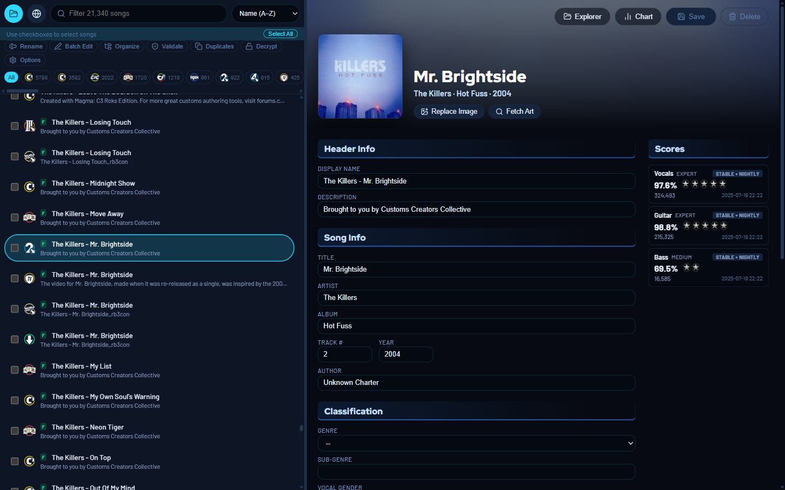
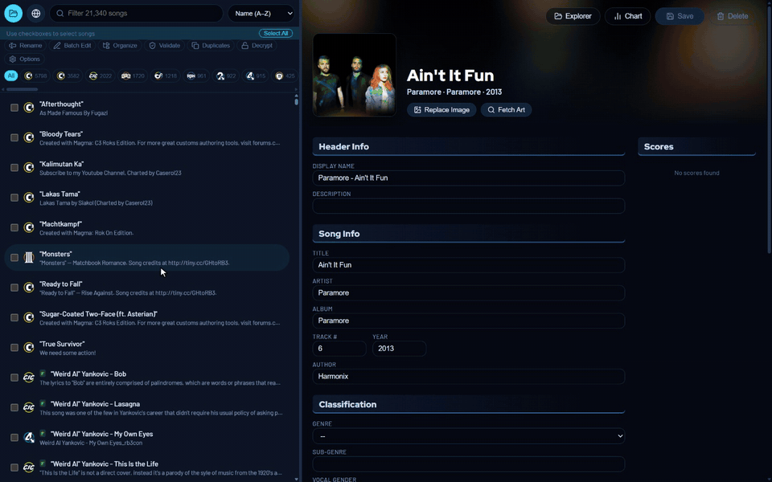
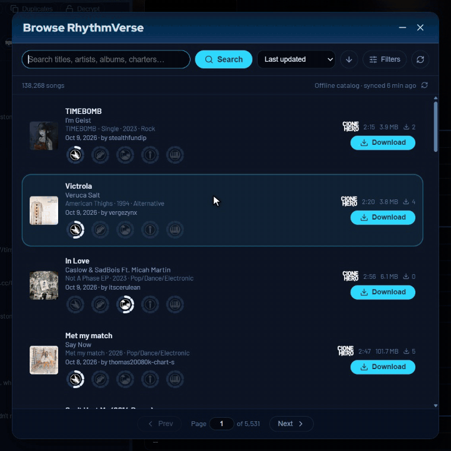
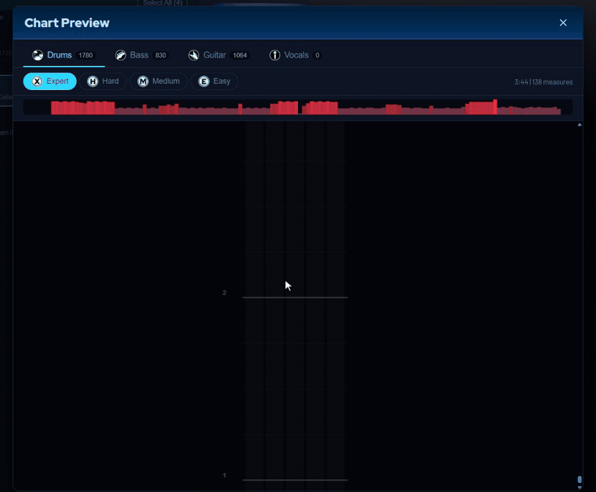
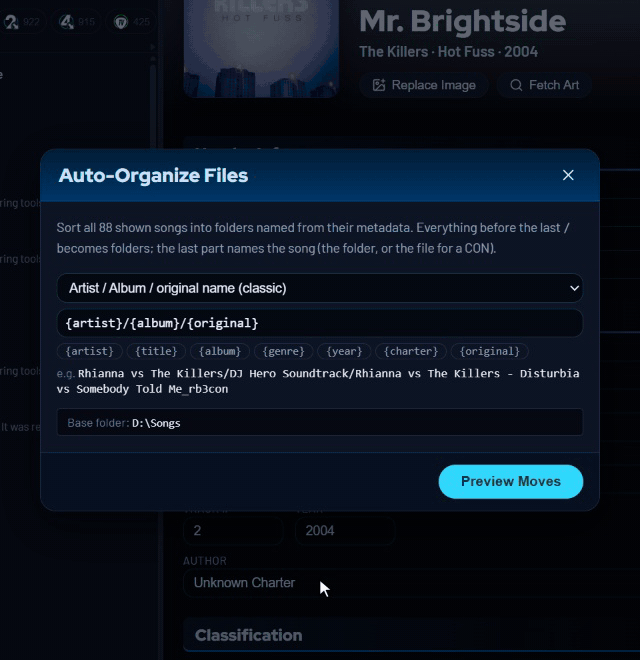
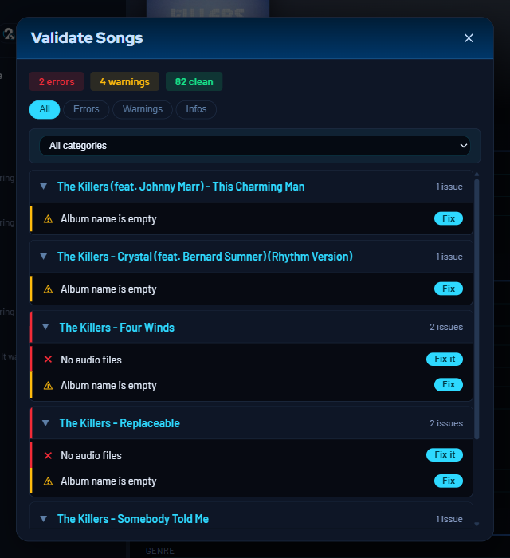
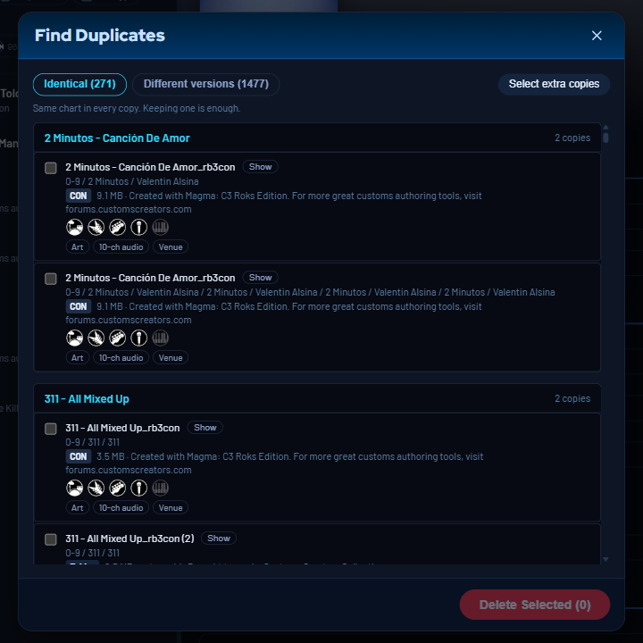
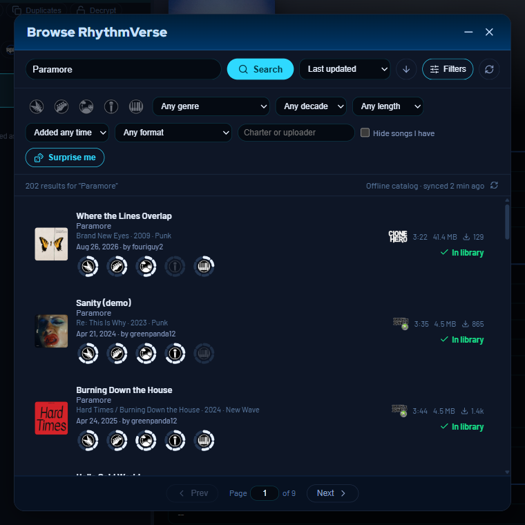

# YARGLE

**YARG Library Editor**: a desktop app for Windows and macOS for managing custom-song libraries for [YARG](https://yarg.in/) (Yet Another Rhythm Game) and other Rock Band–style rhythm games.

[](https://github.com/djrobson5/YARGLE/releases/latest)  [](LICENSE)



YARGLE understands both formats a custom-song library contains:

- **Xbox 360 CON/STFS packages** (`*_rb3con` and friends), read and edited in place with a custom STFS implementation that preserves the original block/hash layout
- **Unpacked song folders** (`song.ini` + `notes.mid`/`notes.chart` + audio + art)

Both go through the same editor, so a library that mixes the two works the same way. It stays fast on big collections: a 21,000-song library on an external drive opens in seconds.

## See it in action

### Find a song, fix its info, check a range
Filter the whole library as you type, open any song to edit its metadata, and hold **Shift** to check or uncheck a run of songs in one click. Toolbar actions (Batch Edit, Rename, Organize, Validate, Decrypt) apply to the checked songs, or to whatever the filter is showing when nothing is checked.

<p align="center"></p>

### Browse and download from RhythmVerse
Search RhythmVerse's full catalog from inside the app, even offline once the catalog has synced. Filter by instrument, genre, decade, length, format or charter, hide songs you already own, and download straight into your library.

<p align="center"></p>

### Preview a chart before you play it
See per-instrument note counts, a density graph, and a scrolling note highway for every difficulty, parsed straight from the MIDI.

<p align="center"></p>

### Organize folders with a template
Build a folder layout from tags like `{genre}/{artist}/{artist} - {title}`, see an example update as you type, and preview every move before anything is touched.

<p align="center"></p>

## Features

### Metadata editing
- Edit song info (title, artist, album, track, year, genre, difficulty, rating, vocal gender, source icon, …) for CON files (`songs.dta`) and song folders (`song.ini`)
- Edit the package display name, description, and thumbnail
- Fetch album art from iTunes or the MusicBrainz Cover Art Archive
- Missing artist or title? YARGLE suggests them from the file name
- Saves keep the original formatting: the DTA round-trip preserves comments, and `song.ini` keeps its line endings

### Library tools
- **Fast scans of huge libraries.** A persistent scan cache means a 20k-song library loads in seconds after the first scan, and YARGLE reopens your last folder on launch
- **Batch edit** a field across many songs at once
- **Batch rename** CON files from their metadata (`Artist - Title_rb3con`)
- **Organize** into folders from a naming template, with a full preview first
- **Validator** catches missing chart or audio files and missing or invalid metadata that can make YARG skip or misidentify a song. Most issues have a one-click **Fix**, and a broken song can be re-downloaded from RhythmVerse with **Fix it**
- **Duplicate finder** compares the charts themselves, so it can tell identical copies (safe to remove) from different versions by other charters
- **Deletes go to the Recycle Bin** (or the Trash on macOS), never straight off the disk
- **MOGG decryption** (via [themethod3](https://github.com/DarkRTA/themethod3))
- **YARG scores**: best score per instrument and difficulty, pulled from both YARG Stable and Nightly, on Windows and macOS

<table>
  <tr>
    <td width="50%"></td>
    <td width="50%"></td>
  </tr>
  <tr>
    <td align="center"><sub>Validator: errors, warnings, and one-click fixes</sub></td>
    <td align="center"><sub>Duplicates: identical copies vs. different versions</sub></td>
  </tr>
</table>

### RhythmVerse integration
- Browse and search [RhythmVerse](https://rhythmverse.co/) without leaving the app, newest uploads first, with instrument difficulty rings, uploader, upload date, size, and download counts
- **Offline catalog**: after one sync, search and filters work instantly, even without a connection
- Filters for instruments, genre, decade, length, date added, format, and charter, plus **Hide songs I have** and **Surprise me**
- One-click downloads straight into your library, up to 3 at a time. Zips, 7z, RAR and loose CON files are all unpacked and added automatically, including files hosted on Google Drive, Mediafire, and Dropbox
- "In library" badges show what you already have, and songs that got an **update** on RhythmVerse since you downloaded them can be re-downloaded and replaced in one click
- Minimize the browser to keep downloading while you work on your library

<p align="center"></p>

### Look and feel
- Dark theme with YARG's own colors, fonts, and instrument and difficulty icons
- Resizable panes, a virtualized list that stays smooth at 20k+ songs, and sorting by name or **recently added**
- One-click in-app updates on Windows: when a new release is out, **Update now** downloads it and restarts YARGLE (on macOS YARGLE links to the release page instead)

## Install

**Windows:** grab `yargle.exe` from the [latest release](https://github.com/djrobson5/YARGLE/releases/latest) and run it. There's no installer, and once it's running YARGLE keeps itself up to date.

**macOS:** download `YARGLE_<version>_universal.dmg` from the [latest release](https://github.com/djrobson5/YARGLE/releases/latest), open it, and drag YARGLE into Applications. It runs natively on both Apple Silicon and Intel Macs. The app isn't notarized by Apple yet, so the first time you open it macOS will block it: go to **System Settings → Privacy & Security** and click **Open Anyway**.

## Building from source

Prerequisites: [Rust](https://rustup.rs/) (stable) and [Node.js](https://nodejs.org/). On macOS you also need the Xcode Command Line Tools (`xcode-select --install`).

```bash
npm install
npm run tauri dev     # development build with hot reload
npm run tauri build   # release build (see below for where it lands)
```

- **Windows:** `src-tauri/target/release/yargle.exe`
- **macOS:** for just the app, run `npm run tauri build -- --bundles app`, which produces `src-tauri/target/release/bundle/macos/YARGLE.app`. For the universal (Apple Silicon + Intel) installer, run `rustup target add x86_64-apple-darwin` once, then `npm run tauri build -- --target universal-apple-darwin --bundles app,dmg`, which produces `src-tauri/target/universal-apple-darwin/release/bundle/dmg/YARGLE_<version>_universal.dmg`.

Stack: [Tauri 2](https://tauri.app/) (Rust backend), React 19 + TypeScript + Vite frontend.

## License

[MIT](LICENSE)

## Notes & credits

- Not affiliated with YARG, RhythmVerse, Harmonix, or Microsoft.
- RhythmVerse integration uses the site's public endpoints politely (an honest User-Agent and a few downloads at a time). RhythmVerse indexes freely shared, legal custom charts, so support them at [rhythmverse.co](https://rhythmverse.co/).
- The color palette follows [YARG](https://github.com/YARC-Official/YARG)'s menu design, and the instrument and difficulty icons are YARG's own sprites. UI icons are from [Lucide](https://lucide.dev) (ISC). UI fonts are [Barlow](https://github.com/jpt/barlow) and [Red Hat Display](https://github.com/RedHatOfficial/RedHatFont), both under the SIL Open Font License (see `src/assets/fonts/`).
- MOGG decryption by [DarkRTA/themethod3](https://github.com/DarkRTA/themethod3); texture decoding via [texture2ddecoder](https://crates.io/crates/texture2ddecoder); MIDI parsing via [midly](https://crates.io/crates/midly).
- Thanks to the C3 / customs community for two decades of keeping plastic guitars alive.
